<div style="text-align: center; font-size: 20px; font-weight: bold;">智图匀影——遥感GIS瓦片图全流程智能处理工具集 V1.0</div>
<div style="text-align: center; font-size: 16px; font-weight: bold;">用户手册</div>


---

## 第1章 系统概述

### 1.1 软件简介

智图匀影是一套面向遥感AI训练数据预处理的全流程GIS瓦片图智能处理工具集。该软件集成了瓦片下载、瓦片分割、瓦片合并、色彩平衡和调色板转换五大功能模块，覆盖了从原始遥感数据获取到AI训练数据制备的完整流程。每个模块均提供图形用户界面（GUI）版本和命令行界面（CLI）版本，GUI版本基于PySide6框架开发，适用于Windows桌面环境，操作直观、所见即所得；CLI版本适用于Linux超算集群等科研计算场景，可通过批处理脚本实现大规模自动化运行。

本软件针对遥感深度学习数据预处理流程中瓦片图处理的实际需求而开发，旨在解决现有GIS软件未针对深度学习瓦片化流程优化、操作繁琐且效率低下的问题，为遥感科研人员提供一套轻量化、全流程闭环的瓦片图智能处理工具集。软件采用Python语言开发，源程序量5829行，运行于Windows 10/11及Linux（CentOS 7 / Ubuntu 20.04+）平台。

### 1.2 功能模块

本软件包含以下五个功能模块，各模块既可独立使用，也可串联形成完整的数据处理流水线：

**瓦片下载工具**：支持Google Earth卫星影像、高德矢量底图、高德卫星影像、高德路网标记四种数据源，通过多线程并行下载实现万级以上瓦片数量的批量获取，支持自定义缩放级别和地理范围。基于墨卡托投影坐标转换算法，将经纬度范围精确映射为瓦片行列号，配合指数退避重试与随机UA机制保障下载稳定性，支持断点续传。

**瓦片分割工具**：将大幅遥感图像按照自定义尺寸自动分割为标准瓦片，基于共享内存的多进程架构实现零拷贝数据共享，可高效处理GB级别的遥感图像。采用Pool.starmap并行调度，通道自适应处理灰度与RGB图像，创新性地提供二维网格进度可视化。

**瓦片合并工具**：将分散的瓦片图片合并为完整的大图，支持多进程并行拼接和实时二维进度可视化，可处理上亿像素的巨幅遥感图像。具备自动参数检测功能，可自动扫描瓦片目录并填充编号范围、步长、瓦片尺寸与通道数，通过共享内存实现并行写入与内存预分配。

**色彩平衡工具**：基于LAB色彩空间梯度分割与直方图匹配算法实现智能色彩平衡，自动检测图像中的色彩边界，支持交互式分割线选择和基准图块校准。采用双阶段边界定位（缩略图粗定位+原图精修）策略，通过多进程池加速直方图匹配，自适应处理不同数据类型的图像。

**调色板转换工具**：将单通道调色板模式TIFF图像转换为标准RGB图像，基于256x3查找表（LUT）实现O(1)索引查找，支持共享内存分块与Cython prange并行加速，采用双层加速策略（Python回退+Cython加速），适合AI训练数据格式标准化。


---

### 1.3 软件架构

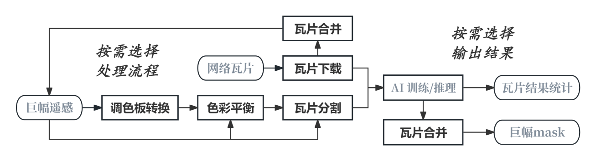

软件采用模块化设计，五个工具相互独立又可串联使用，形成完整的数据处理流水线。整体架构分为三层：用户交互层、核心算法层和并行计算层。

**用户交互层**：GUI版本采用PySide6框架构建用户界面，通过QThread实现后台任务执行，保证界面在耗时操作期间响应流畅，主线程与工作线程之间通过Qt信号（Signal）机制进行通信。CLI版本使用argparse解析命令行参数，配合tqdm进度条，适合在超算集群上通过批处理脚本批量运行。

**核心算法层**：包含墨卡托投影坐标转换、梯度分割与直方图匹配、调色板查找表、通道自适应处理等核心算法。各算法模块以函数形式封装，GUI与CLI版本共享同一套核心算法实现，保证功能一致性。

**并行计算层**：瓦片下载采用ThreadPoolExecutor线程池实现IO密集型任务的并行调度；瓦片分割、合并、色彩平衡、调色板转换均采用multiprocessing.Pool进程池实现计算密集型任务的并行处理，并通过shared_memory模块实现进程间零拷贝数据共享，突破Python多进程默认的内存复制限制。

### 1.4 典型应用场景

**场景一：遥感AI训练数据集制备**。科研人员使用瓦片下载工具获取目标区域的卫星影像，通过瓦片分割工具将大图切分为256x256或512x512的标准瓦片，作为深度学习语义分割、目标检测模型的训练样本。

**场景二：多源遥感影像色彩统一**。不同时期、不同传感器获取的遥感影像拼接后常存在色彩不均问题，使用色彩平衡工具自动检测色彩边界并以基准图块校准，实现全图色彩统一。

**场景三：巨幅遥感影像处理**。上亿像素的巨幅遥感图像超出普通软件处理能力，使用瓦片分割工具将其切分为可管理的小瓦片分别处理，处理完成后再用瓦片合并工具拼接还原。

**场景四：调色板影像格式标准化**。部分遥感数据以调色板模式（P mode）存储，深度学习模型需要标准RGB输入，使用调色板转换工具批量转换格式。

**场景五：超算集群批量处理**。在Linux超算集群上，科研人员通过SLURM作业调度系统批量提交瓦片下载、分割、合并等CLI任务，利用集群的多核CPU和大内存资源高效处理TB级遥感数据集，实现自动化数据生产流水线。

**场景六：历史遥感影像色彩归一化**。不同年份获取的遥感影像由于传感器差异和大气条件影响，存在明显色彩偏差。将多期影像拼接后使用色彩平衡工具，以某一期色彩良好的影像为基准统一全部影像的色彩分布，为时序变化检测提供色彩一致的输入数据。

### 1.5 数据处理流水线

本软件五大模块串联使用可形成完整的遥感AI训练数据制备流水线，典型流程如下：

1. **数据获取**：使用瓦片下载工具，根据研究区域的经纬度范围和所需缩放级别，从Google Earth或高德地图批量下载卫星影像瓦片。
2. **影像合并**：使用瓦片合并工具，将下载的分散瓦片拼接为完整的大幅遥感影像，便于全局色彩处理。
3. **色彩平衡**：使用色彩平衡工具，对拼接后存在色彩不均的大幅影像进行梯度分割与直方图匹配，统一全图色彩分布。
4. **格式标准化**：若影像为调色板模式，使用调色板转换工具转换为标准RGB格式，满足深度学习模型输入要求。
5. **训练数据切分**：使用瓦片分割工具，将处理完成后的大幅影像切分为256x256或512x512的标准瓦片，作为深度学习模型的训练样本。

整个流水线既可在一台工作站上通过GUI版本逐步完成，也可在超算集群上通过CLI脚本自动化批量执行。

### 1.6 设计理念

本软件遵循以下设计理念：**轻量化**——纯Python实现，依赖库少，部署简单，适配超算集群Linux环境；**全流程闭环**——五大模块覆盖完整数据处理链路，避免多软件切换；**双版本设计**——GUI面向桌面交互，CLI面向集群批处理，覆盖科研全场景；**性能优先**——共享内存零拷贝、多进程并行、Cython编译加速等多层优化保障大数据处理效率；**易用性**——自动参数检测、二维进度可视化、分步引导式操作降低使用门槛。


---

## 第2章 运行环境与安装部署

### 2.1 运行环境要求

**操作系统**：Windows 10/11（GUI版本主要运行平台）、Linux CentOS 7 / Ubuntu 20.04+（CLI版本运行平台，适用于超算集群）

**硬件要求**：Intel x86_64架构PC，最低4GB内存；处理GB级大图或上亿像素巨幅图像时建议16GB以上内存；推荐使用SSD存储介质以提升瓦片读写性能。

**Python环境**：Python 3.10（推荐使用MiniForge3或Anaconda管理虚拟环境）

**核心依赖库**：

| 依赖库 | 用途 | 说明 |
| --- | --- | --- |
| PySide6 | GUI界面框架 | 提供Qt组件、信号槽机制、QThread多线程 |
| NumPy | 数值计算 | 数组操作、共享内存数据存储 |
| SciPy | 科学计算 | find_peaks峰值检测、高斯滤波 |
| scikit-image | 图像处理 | match_histograms直方图匹配、色彩空间转换 |
| Pillow (PIL) | 图像读写 | 支持PNG/JPEG/TIFF，调色板模式处理 |
| tifffile | TIFF读写 | 大型TIFF文件高效读写 |
| tqdm | 进度条 | CLI版本进度显示 |
| Matplotlib | 数据可视化 | 色彩平衡预览图绘制 |

### 2.2 环境部署

使用MiniForge3或Anaconda创建Python 3.10虚拟环境，依次安装所需依赖库。建议为新项目创建独立的conda环境，避免与系统其他Python项目产生依赖冲突。部署命令参见源代码目录下的condaSetupCommand.txt文件，典型部署流程如下：

```
conda create -n zhitu python=3.10
conda activate zhitu
conda install -c conda-forge pyside6 numpy scipy scikit-image pillow tifffile tqdm matplotlib
```

环境部署完成后，可通过运行各工具的GUI主程序验证环境是否配置成功。若依赖库版本不兼容，建议优先使用conda-forge渠道安装，以获得经过集成测试的兼容版本组合。


---

### 2.3 GUI版本启动

在Windows环境下，可直接运行打包后的.exe文件启动各工具的GUI版本，无需配置Python环境。也可以在激活conda环境后，通过命令行运行对应的.py源文件：

```
python multiDownload.py    # 启动瓦片下载工具
python tileSplit.py        # 启动瓦片分割工具
python tileCombine.py      # 启动瓦片合并工具
python colorBalance.py     # 启动色彩平衡工具
python paletteTrans.py     # 启动调色板转换工具
```

GUI版本界面基于Qt Designer设计的.ui文件加载，采用信号槽机制连接用户操作与后台逻辑。所有耗时操作均在QThread工作线程中执行，主线程保持响应，用户可随时查看进度和日志。界面采用统一的深色/浅色主题风格，各工具操作逻辑保持一致，降低学习成本。

### 2.4 CLI版本启动

CLI版本通过.bat（Windows）或.sh（Linux）脚本启动，脚本中包含所有参数配置，用户只需修改参数值即可运行，无需记忆命令行参数格式。每个工具目录下均有对应的CLI脚本文件，例如multiDownloadCLI.bat、tileSplitCLI.sh等。CLI版本特别适合在超算集群上通过SLURM等作业调度系统批量提交任务，配合tqdm进度条实时监控处理进度。

CLI版本与GUI版本共享同一套核心算法，功能完全一致，区别仅在于交互方式：GUI通过图形界面输入参数并实时可视化，CLI通过命令行参数和脚本配置运行。在无图形界面的服务器环境或需要自动化批处理的场景下，CLI版本是首选。

### 2.5 版本说明

本软件当前版本为V1.0，软件完成日期为2026年04月15日，首次发表日期为2026年04月22日，发表平台为GitHub开源平台（https://github.com/Zhao-Yuancheng/Remote-sensing-toolkits），首次发表地点为中国甘肃省兰州市。著作权人为赵元丞、王杰，各占50%著作权。本软件为个人合作开发，非企业作品。

### 2.6 环境验证

环境部署完成后，建议按以下步骤验证各模块是否可正常运行：

1. 在命令行中激活conda环境，输入`python -c "import PySide6; print(PySide6.__version__)"`，确认PySide6安装成功并能输出版本号。
2. 输入`python -c "import numpy, scipy, skimage, PIL, tifffile, tqdm, matplotlib; print('all ok')"`，确认所有核心依赖库均可正常导入。
3. 运行任一GUI工具（如`python multiDownload.py`），若界面正常显示则说明GUI环境配置成功。
4. 运行任一CLI工具并查看帮助信息（如`python multiDownloadCLI.py --help`），确认argparse参数解析正常。
5. 若调色板转换工具需要Cython加速，确认palette_processor_cy模块已编译。可在Python中执行`from palette_processor_cy import process_palette_block`验证，若导入失败则工具会自动回退到纯Python版本。

### 2.7 目录结构

软件源代码目录结构如下：

```
智图匀影/
├── multiDownload/          # 瓦片下载模块
│   ├── multiDownload.py        # GUI版本主程序
│   ├── multiDownloadCLI.py     # CLI版本主程序
│   ├── multiDownloadCLI.bat    # Windows启动脚本
│   └── multiDownloadCLI.sh     # Linux启动脚本
├── tileSplit/              # 瓦片分割模块
│   ├── tileSplit.py            # GUI版本主程序
│   ├── tileSplitCLI.py         # CLI版本主程序
│   └── ...
├── tileCombine/            # 瓦片合并模块
│   ├── tileCombine.py          # GUI版本主程序
│   ├── tileCombineCLI.py       # CLI版本主程序
│   └── ...
├── colorBalance/           # 色彩平衡模块
│   ├── colorBalance.py         # GUI版本主程序
│   ├── colorBalanceCLI.py      # CLI版本主程序
│   └── ...
├── paletteTrans/           # 调色板转换模块
│   ├── paletteTrans.py         # GUI版本主程序
│   ├── paletteTransCLI.py      # CLI版本主程序
│   ├── palette_processor_cy.pyx  # Cython源文件
│   ├── palette_processor_cy.c    # Cython编译C文件
│   └── setup.py                  # Cython编译脚本
└── condaSetupCommand.txt   # 环境部署命令
```


---

## 第3章 瓦片下载工具

### 3.1 功能概述

瓦片下载工具支持从Google Earth和高德地图等数据源批量下载地图瓦片。工具通过墨卡托投影坐标转换算法，将用户指定的经纬度范围和缩放级别转换为瓦片行列号，然后使用多线程并行下载。工具支持四种数据源、自定义缩放级别范围（1-22级）、自定义地理范围，并具备指数退避重试、随机User-Agent、断点续传等稳定性保障机制。

### 3.2 界面布局

工具主界面基于PySide6框架构建，整体布局分为四个功能区域：

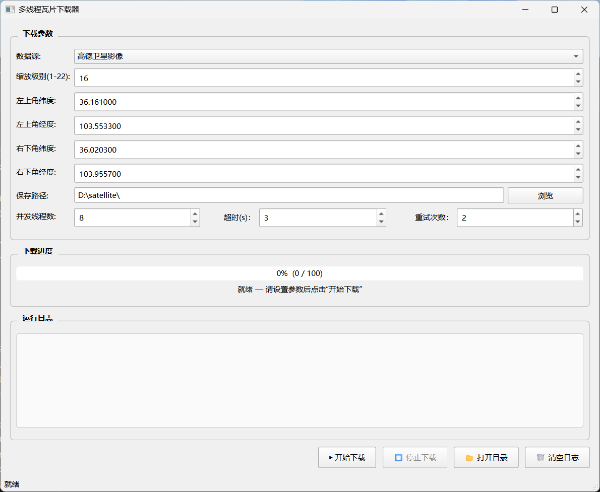

**下载参数区**：位于界面上方，包含数据源选择下拉框、缩放级别设置、地理范围（左上角和右下角经纬度）输入、保存路径选择、并发线程数、超时时间和重试次数等参数配置。

**进度显示区**：位于参数区下方，通过进度条和文字标签实时显示下载进度、已下载数量、成功数量等信息。

**运行日志区**：占据界面主要空间，以彩色时间戳格式记录操作日志、状态变更和错误信息，支持自动滚动。不同级别日志采用不同颜色区分（正常黑色、警告橙色、错误红色）。

**控制按钮区**：位于界面底部，提供开始下载、停止下载、打开保存目录、清空日志四个操作按钮。

**状态栏**：界面最底部显示简要的当前状态提示。


---

### 3.3 操作步骤

**第一步：选择数据源**

在"数据源"下拉框中选择所需的数据源类型。支持四种数据源：Google Earth（卫星影像）、高德矢量底图、高德卫星影像、高德路网标记。默认选择"高德卫星影像"。

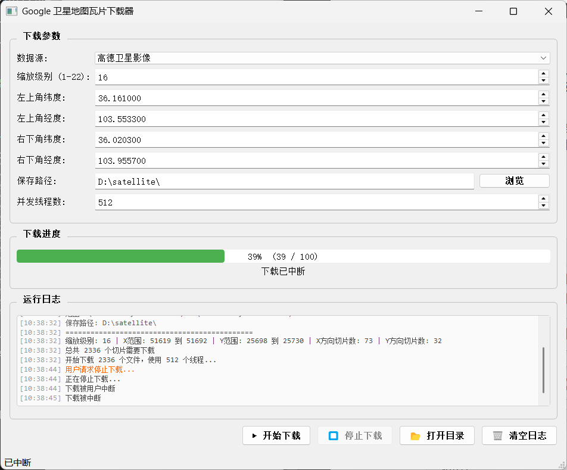

**第二步：设置缩放级别**

在"缩放级别"输入框中设置所需的地图缩放级别（1-22）。级别越高，地图越精细，瓦片数量越多。例如，级别16对应街道级别，级别18对应建筑物级别。CLI版本支持设置级别范围（level_start至level_end），实现多层级批量下载。

**第三步：设置地理范围**

分别输入左上角和右下角的经纬度坐标（WGS84坐标系）。左上角纬度必须大于右下角纬度，左上角经度必须小于右下角经度。界面默认填入兰州市区的坐标范围。工具会进行输入验证，坐标非法时弹出错误提示并阻止下载启动。

**第四步：选择保存路径**

点击"浏览"按钮选择瓦片保存目录，或在文本框中直接输入路径。默认路径为D:\satellite。

**第五步：设置并发参数**

根据网络环境设置并发线程数（1-4096）、超时时间（秒）和重试次数。默认线程数为8，超时3秒，重试2次。在带宽充足的超算环境下可将线程数提升至64甚至更高。

**第六步：开始下载**

点击"开始下载"按钮启动下载任务。下载过程中，进度条实时显示完成百分比，日志区记录详细的下载状态。每完成10个瓦片更新一次进度显示，平衡性能与实时性。

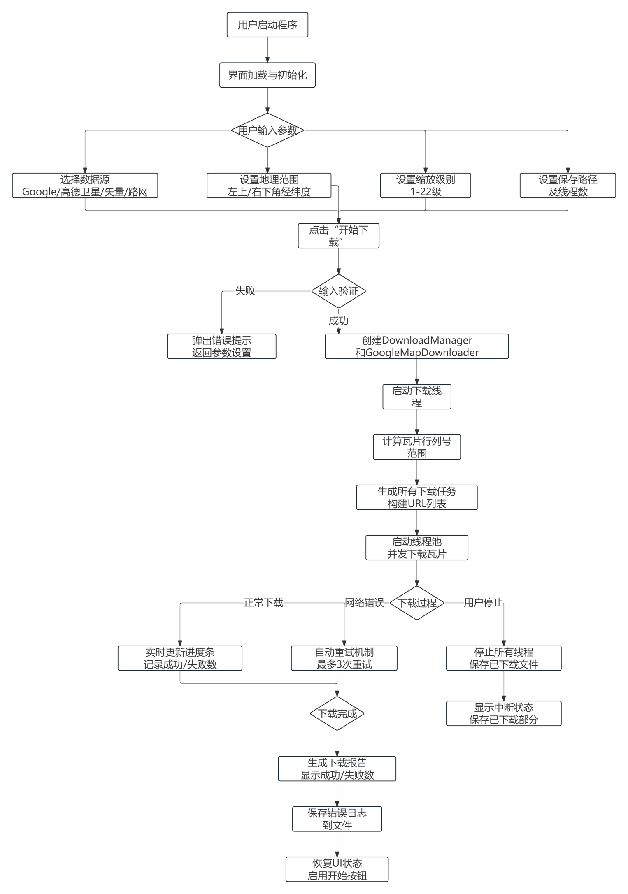

**第七步：查看结果**

下载完成后，系统弹出提示框显示总耗时、成功数和失败数。点击"是"可打开输出目录查看下载结果。下载的瓦片按"数据源/缩放级别/X列/Y行.png"的目录结构组织。


---

### 3.4 技术原理

**墨卡托投影坐标转换算法**：工具采用Web墨卡托投影（EPSG:3857坐标系），将经纬度坐标转换为瓦片行列号。核心算法deg2num实现如下：对于给定纬度lat_deg、经度lon_deg和缩放级别zoom，先计算n = 2^zoom（该级别瓦片总数），再分别计算x列号 = int((lon_deg + 180) / 360 * n)和y行号 = int((1 - ln(tan(lat_rad) + 1/cos(lat_rad)) / pi) / 2 * n)，其中lat_rad为纬度弧度。该算法保证全球范围内经纬度到瓦片索引的精确映射。

**多线程并行下载**：采用concurrent.futures.ThreadPoolExecutor线程池管理并发下载任务。由于瓦片下载属于IO密集型操作，多线程可有效利用网络带宽。线程池动态调度任务，线程数可配置最高4096。配合ThreadSafeCounter线程安全计数器统计下载进度和错误数。

**指数退避重试机制**：网络错误（URLError、HTTPError、ConnectionError、TimeoutError）触发指数退避重试，重试等待时间按2的幂次增长（1秒、2秒、4秒），最多重试3次。指数退避策略有效缓解服务器限流和网络抖动导致的下载失败。

**随机User-Agent机制**：每次请求从预设的User-Agent列表中随机选择一个，模拟不同浏览器的访问行为，降低被服务器识别为爬虫而屏蔽的风险。

### 3.5 参数说明

| 参数 | GUI对应 | 说明 | 取值范围 | 默认值 |
| --- | --- | --- | --- | --- |
| 数据源 source | 数据源下拉框 | 0:Google Earth, 1:高德矢量, 2:高德卫星, 3:高德路网 | 0-3 | 2 |
| 缩放级别 level | 缩放级别输入框 | 地图缩放级别 | 1-22 | 16 |
| 左上角纬度 LT_lat | 左上角纬度输入框 | WGS84纬度 | -90~90 | 36.161 |
| 左上角经度 LT_lon | 左上角经度输入框 | WGS84经度 | -180~180 | 103.5533 |
| 右下角纬度 RB_lat | 右下角纬度输入框 | WGS84纬度 | -90~90 | 36.0203 |
| 右下角经度 RB_lon | 右下角经度输入框 | WGS84经度 | -180~180 | 103.9557 |
| 保存路径 root_dir | 路径选择 | 瓦片保存根目录 | 有效路径 | D:\satellite |
| 并发线程数 workers_num | 线程数输入框 | 并行下载线程数 | 1-4096 | 8 |
| 超时时间 timeout | 超时输入框 | 单次请求超时秒数 | >0 | 3 |
| 重试次数 retries_num | 重试输入框 | 失败重试次数 | >=0 | 2 |


---

### 3.6 数据结构

下载的瓦片按层级目录结构组织，便于后续工具按索引读取：

```
输出根目录/
├── Google Earth/          # 数据源名称
│   ├── 13/                # 缩放级别
│   │   ├── 6742/          # X列号
│   │   │   ├── 3121.png   # Y行号.png
│   │   │   ├── 3122.png
│   │   │   └── ...
│   │   └── ...
│   └── 14/
│       └── ...
├── 高德卫星影像/
│   └── ...
└── download_errors_zoom13.txt  # 错误日志
```

瓦片文件名为Y行号.png，所在目录名为X列号，上级目录名为缩放级别，最上级为数据源名称。该结构与主流GIS瓦片服务标准一致，可直接被瓦片分割、合并工具读取处理。

### 3.7 下载中断与恢复

下载过程中可随时点击"停止下载"按钮中断任务，工具通过停止标志位（_stop_requested）通知工作线程在下一个任务前退出。工具通过文件存在检查机制实现断点续传：重新下载时，已存在的瓦片文件会被自动跳过（os.path.isfile检查），避免重复下载。失败的下载任务信息记录到保存目录下的download_errors_zoom{级别}.txt文件中，包含失败瓦片的X、Y坐标和错误原因，支持后续手动排查或重新下载缺失瓦片。

### 3.8 错误处理

工具采用多层次错误处理机制：网络错误（URLError、HTTPError等）触发指数退避重试，重试等待时间按2的幂次增长（1秒、2秒、4秒），最多重试3次。每次请求使用随机User-Agent，降低被服务器屏蔽的风险。目录创建失败、文件写入失败等系统错误通过error_occurred信号实时反馈到日志区。所有错误信息实时显示在日志区，并用红色标识。下载完成后汇总成功数与失败数，便于用户评估下载质量。

### 3.9 缩放级别与瓦片数量

瓦片数量随缩放级别呈指数增长。第z级的全球瓦片总数为4^z（2^z行 x 2^z列）。下表列出常见缩放级别的瓦片数量参考：

| 缩放级别 | 全球瓦片总数 | 单瓦片地面分辨率（赤道） | 适用场景 |
| --- | --- | --- | --- |
| 8 | 65,536 | 约611米 | 城市级概览 |
| 12 | 16,777,216 | 约38米 | 区域级 |
| 14 | 268,435,456 | 约9.6米 | 街区级 |
| 16 | 4,294,967,296 | 约2.4米 | 街道级 |
| 18 | 68,719,476,736 | 约0.6米 | 建筑物级 |

实际下载的瓦片数量取决于地理范围和缩放级别。下载前工具会计算总任务数并在日志区显示，便于用户预估下载耗时和存储空间需求。

### 3.10 数据源说明

四种数据源的特点和适用场景：

| 数据源 | 编号 | 内容 | 特点 |
| --- | --- | --- | --- |
| Google Earth | 0 | 卫星影像 | 全球覆盖，分辨率高 |
| 高德矢量底图 | 1 | 矢量地图 | 包含道路、地名标注，文件小 |
| 高德卫星影像 | 2 | 卫星影像 | 国内覆盖好，更新及时 |
| 高德路网标记 | 3 | 路网叠加 | 透明背景路网，可叠加影像 |

用户可根据研究需求选择合适的数据源。对于遥感AI训练，通常选择卫星影像数据源（0或2）；对于地理标注任务，可叠加路网标记数据源。


---

## 第4章 瓦片分割工具

### 4.1 功能概述

瓦片分割工具将大幅遥感图像按照自定义尺寸自动分割为标准瓦片。工具采用基于共享内存的多进程架构，子进程通过共享内存直接访问原始图像数据，实现零拷贝数据共享，可高效处理GB级别的遥感图像。工具支持PNG、JPEG、TIFF等多种输出格式，通道自适应处理灰度与RGB图像，并提供创新的二维网格进度可视化。

### 4.2 界面布局

工具界面基于Qt Designer创建的PySide6界面，整体布局如下：

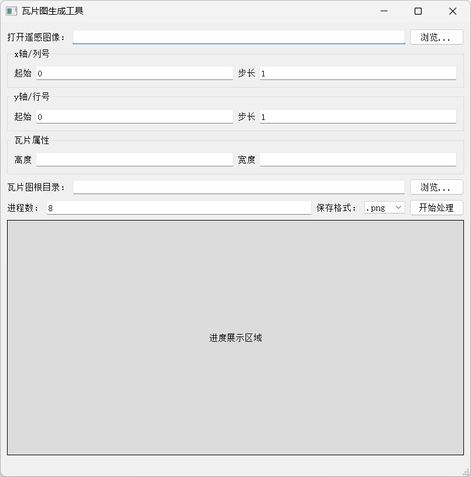

**输入参数区**：包含"打开遥感文件"路径选择和"瓦片图保存根目录"路径选择。

**瓦片参数设置区**：包含X轴起点、X轴步长、Y轴起点、Y轴步长、瓦片宽度、瓦片高度、输出格式（下拉选择PNG/JPEG/TIFF）、通道数、进程数等参数。

**处理控制区**：包含"开始处理"按钮，处理期间按钮变为"处理中..."并禁用，防止重复提交。

**进度可视化区**：通过QLabel动态显示黑白网格，白色方块表示已完成的瓦片，黑色方块表示未处理。网格从全黑逐渐变为全白，直观展示处理进度的空间分布。

**状态栏**：显示处理状态、进度百分比和瓦片计数。


---

### 4.3 操作步骤

**第一步：选择输入文件**

点击"浏览"按钮选择待分割的大尺寸遥感图像。支持PNG、JPEG、TIFF等格式。工具自动读取图像尺寸和通道数。

**第二步：设置保存目录**

点击"浏览"按钮选择瓦片保存的根目录。分割后的瓦片将按X/Y索引自动创建子目录。

**第三步：设置瓦片参数**

设置瓦片的宽度、高度（像素），以及X轴和Y方向的起始编号和步长。通常起始编号为0，步长为1。选择输出格式（PNG、JPEG或TIFF）。设置通道数（1为灰度，3为RGB）。

**第四步：设置进程数**

根据CPU核心数设置并行处理进程数。建议设置为CPU核心数或略少于核心数，以充分利用多核性能。

**第五步：开始处理**

点击"开始处理"按钮启动分割过程。工具首先将原始图像数据复制到共享内存，创建进度共享内存，然后通过进程池并行分割。处理期间界面实时显示二维进度网格和百分比。

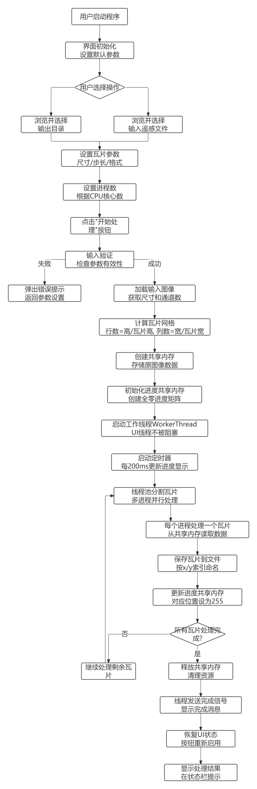

**第六步：查看结果**

处理完成后，系统弹出提示框询问是否打开输出目录。分割结果按"根目录/X索引/Y索引.格式"的目录结构保存。

### 4.4 技术原理

**共享内存零拷贝架构**：工具使用multiprocessing.shared_memory模块创建共享内存块，将原始图像的NumPy数组数据一次性复制到共享内存。所有子进程通过共享内存名称（shm_name）打开同一块内存，直接读取图像数据，无需进程间数据序列化传输。这种零拷贝设计突破了Python多进程默认通过pickle序列化传递数据的性能瓶颈，对GB级大图尤为关键。

**多进程Pool.starmap并行调度**：使用multiprocessing.Pool创建进程池，通过pool.starmap(split_tile, params_list)将所有瓦片分割任务并行分发到各进程。starmap自动将参数列表中的每个元组解包为函数参数，实现高效的批量任务调度。

**通道自适应处理**：工具根据用户指定的通道数与图像实际通道数进行自适应转换。单通道图像可转换为RGB（灰度值复制到三个通道），三通道图像可转换为单通道（转换为灰度），保证输出瓦片通道数符合用户需求。


---

### 4.5 进度可视化

工具创新性地采用二维网格进度显示：根据图像的瓦片分割数量创建对应大小的灰度矩阵（进度共享内存），每个瓦片对应矩阵中的一个像素点。瓦片处理完成后，对应的矩阵位置从0（黑色）变为255（白色），通过QImage实时渲染显示。这种可视化方式使用户能够直观地看到处理进度的空间分布，而不仅仅是百分比数字——例如可以观察到处理是否按行扫描、是否有区域处理缓慢等。

主线程通过定时器定期读取进度共享内存，将灰度矩阵渲染为QImage并显示在QLabel上，实现实时刷新。进度共享内存同样采用共享内存机制，避免子进程进度反馈的通信开销。

### 4.6 参数说明

| 参数 | 说明 | 取值范围 | 默认值 |
| --- | --- | --- | --- |
| file_path | 输入遥感图像路径 | 有效图像文件 | - |
| result_dir | 瓦片保存根目录 | 有效路径 | - |
| result_format | 输出格式 | png/jpeg/tiff | png |
| x_begin | X轴起始编号 | 整数 | 0 |
| x_step | X轴步长 | 正整数 | 1 |
| y_begin | Y轴起始编号 | 整数 | 0 |
| y_step | Y轴步长 | 正整数 | 1 |
| tile_width | 瓦片宽度（像素） | 正整数 | 256 |
| tile_height | 瓦片高度（像素） | 正整数 | 256 |
| tile_channels | 通道数 | 1（灰度）/3（RGB） | 3 |
| proc_num | 进程数 | 1~CPU核心数 | CPU核心数 |

### 4.7 数据结构

输出根目录的文件组织结构如下：

```
输出根目录/
├── 0/           # x=0的瓦片目录
│   ├── 0.png    # (x=0, y=0)瓦片
│   ├── 1.png    # (x=0, y=1)瓦片
│   └── ...
├── 1/           # x=1的瓦片目录
│   ├── 0.png
│   ├── 1.png
│   └── ...
└── ...
```
目录名和文件名中的编号由起始编号和步长决定：X索引 = x_begin + x_idx * x_step，Y索引 = y_begin + y_idx * y_step。该命名规则与瓦片下载工具的输出结构兼容，支持无缝衔接后续处理。

### 4.8 边缘处理与瓦片计数

当图像尺寸不是瓦片尺寸的整数倍时，边缘区域无法生成完整瓦片。工具的处理策略为：完整瓦片数量为floor(图像宽度/瓦片宽度) x floor(图像高度/瓦片高度)，边缘剩余像素（图像宽度 mod 瓦片宽度）被忽略。工具在处理前会计算并提示剩余像素数量，用户可据此判断是否需要调整瓦片尺寸或图像裁剪。

例如，对于40000x40000像素的图像，使用256x256瓦片分割，可生成156x156=24336个完整瓦片，剩余64x64像素的边缘被忽略。若需包含边缘，可将瓦片尺寸调整为250x250（恰好整除），或先对图像进行边缘填充。


---

### 4.9 错误处理

**内存不足**：处理超大图像时，共享内存分配可能失败。工具会在分配前计算所需内存并显示，超过1GB时会发出警告，提示用户确认。若系统内存不足导致分配失败，工具捕获异常并提示用户减小图像尺寸或增加系统内存。

**图像尺寸非瓦片整数倍**：图像边缘的剩余像素无法生成完整瓦片，工具会提示剩余像素数量。这些边缘区域将被忽略，不影响主体区域的分割处理。

**通道数不匹配**：如果指定的通道数与图像实际通道数不一致，工具会发出警告并执行自适应转换。单通道图像可转换为RGB，三通道图像可转换为单通道灰度。

**共享内存清理**：工具在处理完成或异常退出时，通过cleanup方法主动关闭并释放共享内存，避免内存泄漏。若程序异常崩溃导致共享内存未释放，下次启动时工具会检测并清理残留的共享内存块。

### 4.10 共享内存架构详解

瓦片分割的共享内存架构工作流程如下：

1. **主进程加载图像**：主进程通过PIL/tifffile读取原始遥感图像为NumPy数组，获取图像高度H、宽度W和通道数C。
2. **计算共享内存大小**：根据图像尺寸和数据类型计算所需字节数（H x W x C x dtype大小）。若超过1GB则发出警告。
3. **创建共享内存**：通过shared_memory.SharedMemory(name=shm_name, create=True, size=所需字节数)创建共享内存块，将图像数组数据复制进去。
4. **创建进度共享内存**：创建一块大小为x_num x y_num的共享内存用于存储进度矩阵，初始全为0（黑色）。
5. **分发任务**：构建参数列表params_list，每个元素包含一个瓦片的坐标范围和共享内存名称。通过pool.starmap(split_tile, params_list)并行执行。
6. **子进程处理**：每个子进程通过共享内存名称打开图像共享内存（create=False），读取对应区域的像素数据，保存为瓦片文件，并将进度共享内存对应位置置为255（白色）。
7. **主进程监控**：主线程定时读取进度共享内存，渲染为二维网格图像显示。
8. **清理释放**：处理完成后关闭并释放两块共享内存。

这种架构下，无论图像多大，仅在创建共享内存时进行一次数据复制，之后所有子进程共享同一块内存，避免了传统多进程方案中每个任务都需序列化传输图像切片的开销。


---

## 第5章 瓦片合并工具

### 5.1 功能概述

瓦片合并工具将分散的瓦片图片合并为完整的大图。工具支持多进程并行拼接，通过共享内存存储总图数据，每个子进程负责读取一个瓦片并放置到总图的正确位置。工具可处理上亿像素的巨幅遥感图像，具备自动参数检测、通道自适应合并、内存预分配等特性。

### 5.2 界面布局

瓦片合并工具的界面与分割工具类似，包含以下区域：

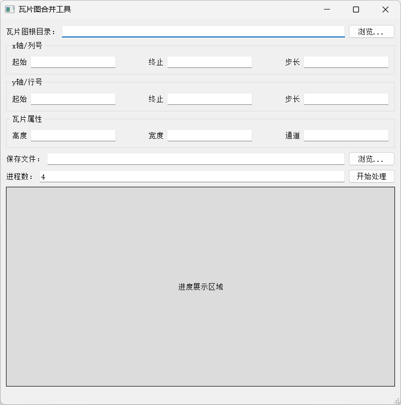

**瓦片图根目录**：选择包含瓦片文件的根目录。选择目录后，工具自动扫描目录结构，自动填充X/Y轴的起始值、终止值、步长，以及瓦片的宽度、高度和通道数。

**保存文件路径**：选择合并结果的保存路径，支持PNG、TIFF、JPEG格式。

**参数设置区**：显示自动检测的瓦片参数，用户可手动修改。包含X轴起始/终止/步长、Y轴起始/终止/步长、瓦片宽度/高度/通道数、进程数。

**进度可视化区**：与分割工具相同的二维网格进度显示。

### 5.3 操作步骤

**第一步：选择瓦片目录**

点击"浏览"按钮选择瓦片图根目录。工具自动扫描目录结构，检测X/Y方向的瓦片编号范围和瓦片属性。

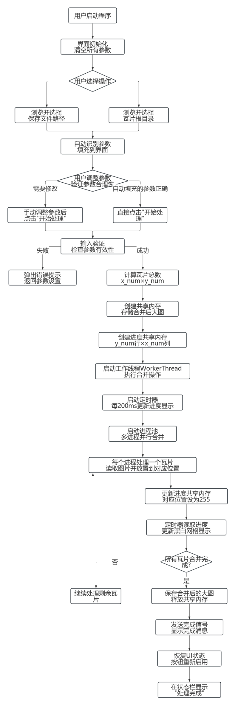

**第二步：确认参数**

检查自动填充的参数是否正确，包括X/Y轴范围、步长、瓦片尺寸和通道数。如有需要可手动修改。

**第三步：选择保存路径**

点击"浏览"按钮选择合并结果的保存路径，或直接在文本框中输入路径。

**第四步：设置进程数**

根据CPU核心数设置并行处理进程数。

**第五步：开始处理**

点击"开始处理"按钮启动合并过程。工具预先分配总图共享内存，通过进程池并行读取瓦片并写入总图。处理期间界面实时显示二维进度网格。

**第六步：查看结果**

处理完成后，系统弹出提示框询问是否打开输出文件所在目录。合并结果保存为单张大图文件。


---

### 5.4 技术原理

**自动参数检测**：当用户选择瓦片根目录后，工具自动执行以下检测：扫描所有以数字命名的子目录（X方向），获取最小和最大X值作为x_begin和x_end；扫描第一个X目录下的瓦片文件，获取最小和最大Y值及文件扩展名作为y_begin、y_end和tile_format；打开第一个瓦片文件，读取实际宽度和高度，检测通道数（通过NumPy数组shape判断）。自动计算步长（通过相邻编号差值），减少用户手动输入，降低出错概率。

**共享内存并行写入**：工具创建一块与总图尺寸等大的共享内存，预先初始化为零值（黑色）。每个子进程通过共享内存名称打开总图内存，读取对应的瓦片文件后，将瓦片数据直接写入总图的对应区域。多个进程并行写入不同区域，互不冲突，实现高效的并行拼接。

**通道自适应合并**：工具根据检测到的通道数自适应处理。若瓦片为单通道而总图需RGB，则将灰度值复制到三个通道；若瓦片为RGB而总图为单通道，则转换为灰度。保证不同通道数的瓦片都能正确合并。

**内存预分配**：工具在处理前根据瓦片数量和尺寸预先计算总图尺寸，一次性分配共享内存，避免处理过程中动态扩容带来的性能开销。对于超大图像，工具会预先计算内存需求并提示用户。

### 5.5 参数说明

| 参数 | 说明 | 取值范围 | 默认值 |
| --- | --- | --- | --- |
| root_dir | 瓦片图根目录 | 有效路径 | - |
| result_path | 合并结果保存路径 | 有效路径 | - |
| x_begin | X轴起始编号 | 整数 | 自动检测 |
| x_end | X轴终止编号 | 整数 | 自动检测 |
| x_step | X轴步长 | 正整数 | 自动检测 |
| y_begin | Y轴起始编号 | 整数 | 自动检测 |
| y_end | Y轴终止编号 | 整数 | 自动检测 |
| y_step | Y轴步长 | 正整数 | 自动检测 |
| tile_width | 瓦片宽度（像素） | 正整数 | 自动检测 |
| tile_height | 瓦片高度（像素） | 正整数 | 自动检测 |
| tile_format | 瓦片文件后缀 | .png/.jpg/.tif | 自动检测 |
| tile_channels | 通道数 | 1/3 | 自动检测 |
| proc_num | 进程数 | 1~CPU核心数 | CPU核心数 |


---

### 5.6 数据结构

合并工具读取的瓦片目录结构与分割工具输出结构一致：

```
瓦片根目录/
├── 1651817/              # x=1651817的瓦片目录
│   ├── 822436.png        # (x=1651817, y=822436)瓦片
│   ├── 822440.png        # 步长为4时的下一个瓦片
│   └── ...
├── 1651821/
│   └── ...
└── ...
```

合并后的总图尺寸为：宽度 = (x_end - x_begin) / x_step * tile_width + tile_width，高度 = (y_end - y_begin) / y_step * tile_height + tile_height。每个瓦片在总图中的位置为：左上角X = (x - x_begin) / x_step * tile_width，左上角Y = (y - y_begin) / y_step * tile_height。

### 5.7 错误处理

**瓦片文件缺失**：合并时如果某些瓦片文件不存在，对应位置将保持黑色（初始值0）。工具会统计并报告失败的瓦片位置，便于用户排查缺失瓦片。

**输出图像过大**：合并大量高分辨率瓦片会生成超大图像，需要足够的内存。工具会预先计算输出图像尺寸和内存需求，超过1GB时发出警告，提示用户确认。

**参数检测异常**：若瓦片目录结构不符合预期（如非数字命名的子目录），自动检测可能失败。工具会提示用户手动输入参数。

**共享内存清理**：与分割工具相同，合并工具在处理完成或异常退出时主动释放共享内存，避免内存泄漏。

### 5.8 并行写入架构详解

瓦片合并的共享内存并行写入架构工作流程：

1. **参数计算**：根据X/Y轴范围和步长计算总图的行列数和像素尺寸，根据瓦片尺寸和通道数计算总图共享内存大小。
2. **内存预分配**：创建总图共享内存并初始化为零值（黑色背景），一次性分配所需内存。
3. **任务构建**：为每个瓦片构建任务参数，包含瓦片路径和在总图中的目标偏移量（x_offset, y_offset）。
4. **并行读取写入**：通过进程池并行执行，每个子进程打开总图共享内存，读取一个瓦片文件，将瓦片数据写入总图共享内存的对应区域。多个进程写入不同区域互不冲突。
5. **缺失处理**：若某瓦片文件不存在，对应区域保持黑色（零值），工具记录缺失瓦片位置。
6. **结果保存**：所有瓦片写入完成后，主进程从共享内存读取完整总图数据，保存为输出文件。
7. **清理释放**：释放总图共享内存。

该架构的关键优势在于总图数据仅存在一份共享内存副本，所有进程直接写入，避免了合并结果回传主进程的通信开销。对于上亿像素的巨幅图像，这种设计大幅降低了内存占用和通信成本。

### 5.9 输出验证与质量控制

合并完成后，建议按以下步骤验证输出质量：

1. **检查输出文件尺寸**：确认输出图像的宽高与预期一致。总图宽度应为(x_end - x_begin) / x_step * tile_width + tile_width，高度同理。
2. **检查黑色区域**：若输出图像存在黑色块，说明对应位置的瓦片文件缺失。可查看工具报告的失败瓦片位置列表，补下缺失瓦片后重新合并。
3. **检查色彩一致性**：若合并的瓦片来自不同批次下载，可能存在色彩差异。建议对合并结果使用色彩平衡工具进行统一校准。
4. **检查通道数**：确认输出图像的通道数与预期一致。若瓦片为单通道而期望RGB输出，需检查通道数设置是否正确。


---

## 第6章 色彩平衡工具

### 6.1 功能概述

色彩平衡工具解决多源遥感图像拼接后存在的色彩不均问题。工具基于LAB色彩空间梯度分割算法自动检测图像中的色彩边界，通过直方图匹配算法将各分块的色彩统一到基准图块的色彩分布。工具支持交互式操作，用户可在自动检测结果基础上手动调整分割线，实现精准的色彩校准。采用双阶段边界定位（缩略图粗定位+原图精修）策略，通过多进程池加速直方图匹配，自适应处理不同数据类型的图像。

### 6.2 界面与操作流程

色彩平衡工具的GUI版本采用分步引导式操作，每一步均有界面提示。

**第一步：设置分割灵敏度**

启动工具后，界面显示分割灵敏度设置窗口。灵敏度范围为1-20，默认值为5。灵敏度越高，检测到的分割线越多，分割越精细。

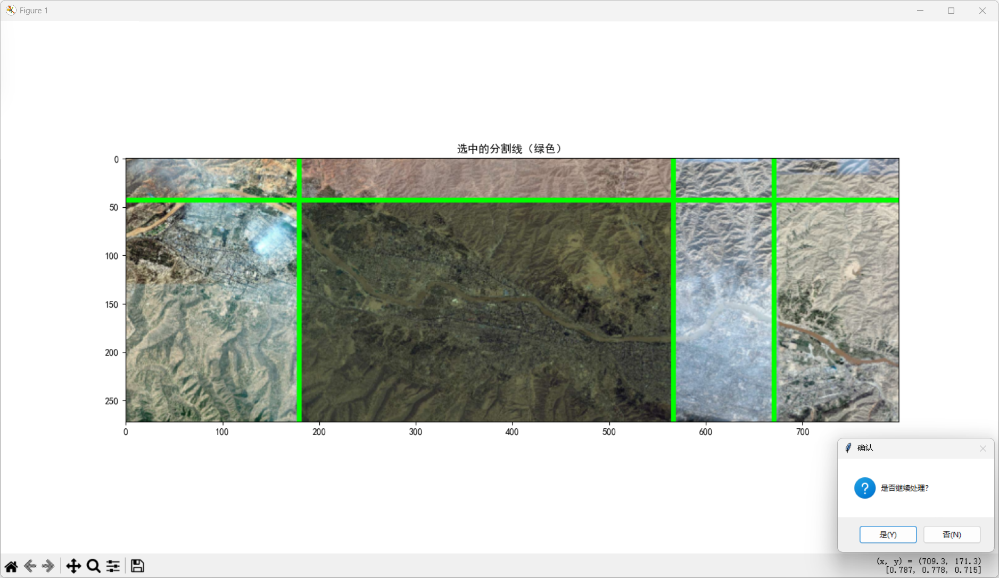

**第二步：选择输入图片**

点击"开始处理图片"按钮后，弹出文件选择对话框。支持PNG、JPG、BMP、TIF等多种图像格式。工具自动读取图像并检查通道数，非RGB模式的图像会提示错误。

**第三步：查看原始缩略图**

工具将原图缩放至最大边800像素生成缩略图并显示。用户确认后继续处理。缩略图用于后续的快速边界检测和预览。

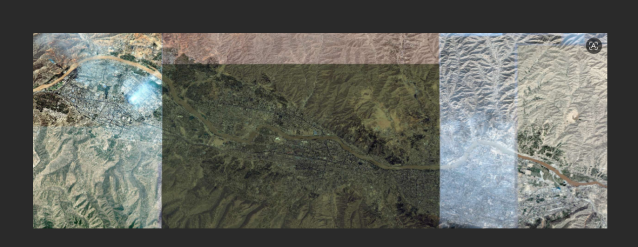


---

**第四步：查看自动检测的分割线**

工具基于Lab色彩空间的L通道（亮度），计算水平方向的梯度，通过高斯滤波平滑后寻找梯度峰值，作为潜在的色彩边界。检测到的分割线以红色线条标注在缩略图上。

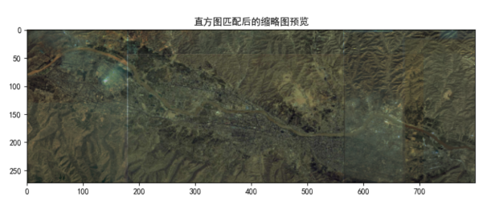

**第五步：选择保留的分割线**

用户通过对话框输入需要保留的竖直分割线和水平分割线序号（从1开始，用空格分隔）。未选中的分割线将被忽略。此步骤允许用户剔除误检的分割线，保留真正的色彩边界。

**第六步：确认选中分割线**

选中的分割线以绿色线条显示在缩略图上。用户确认后继续。

**第七步：查看图像分块预览**

工具将图像按选中的分割线划分为多个区块，以网格形式展示各区块预览。

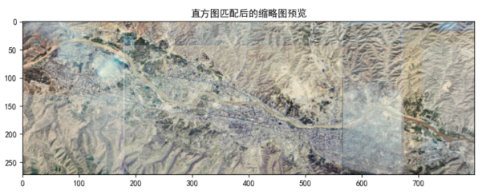

**第八步：选择基准图块**

用户输入基准图块的行号和列号。其他所有区块将以该图块的色彩分布为基准进行直方图匹配。基准图块通常选择色彩表现最自然、最具代表性的区域。

**第九步：预览处理效果**

工具在缩略图上执行直方图匹配，显示处理后的预览效果。用户可对比处理前后的色彩差异，若不满意可返回调整分割线或基准图块。

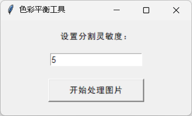

**第十步：处理原图并保存**

确认预览效果后，工具在原图上执行精确的边界检测（在缩略图检测位置附近重新检测，即双阶段定位的精修阶段），然后使用多进程池并行执行直方图匹配。处理完成后，用户选择保存路径，工具保存处理后的图像。

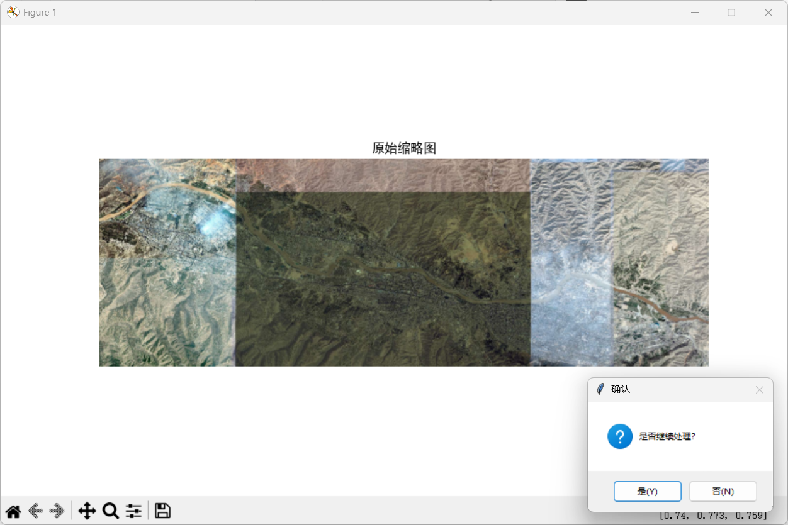

**第十一步：对比处理前后效果**

保存完成后，工具可显示处理前后的对比图，用户可直观评估色彩平衡效果。处理前各分块存在明显色差，处理后各分块色彩统一到基准图块的色彩分布。


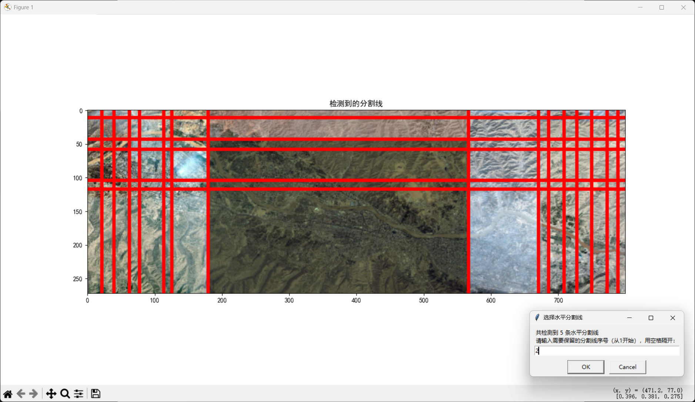


---

### 6.3 技术原理

**LAB色彩空间梯度检测**：将图像从RGB色彩空间转换到Lab色彩空间，提取L通道（亮度）。在L通道上计算水平方向的梯度（使用卷积核[-1, 0, 1]），通过高斯滤波（sigma=2）平滑梯度场。对梯度场沿列方向求均值，得到梯度分布曲线。使用scipy.signal.find_peaks函数寻找梯度峰值，峰值位置即为潜在的色彩边界。Lab色彩空间的L通道与人眼亮度感知一致，能够有效捕捉色彩过渡边界。竖直边界检测（detect_color_boundaries_vertical）和水平边界检测（detect_color_boundaries_horizontal）分别处理两个方向的色彩分界。

**双阶段边界定位**：第一阶段在缩略图（最大边800像素）上快速检测色彩边界，获得粗略的分割线位置；第二阶段在原图处理时，以缩略图检测位置为中心，在原图对应区域附近重新执行精确的梯度峰值检测（detect_original_vertical/detect_original_horizontal），修正缩略图缩放带来的位置偏差。这种双阶段策略既保证了检测速度，又确保了原图分割的精度。

**直方图匹配**：对每个非基准图块，将其色彩直方图调整至与基准图块一致。该操作使用scikit-image的match_histograms函数，在Lab色彩空间的各通道上独立进行，确保色彩、亮度和对比度的全面匹配。直方图匹配通过调整像素值的累积分布函数（CDF），使目标图块的CDF与基准图块对齐，从而实现色彩分布的统一。

**多进程加速**：原图处理阶段使用共享内存存储完整图像，通过multiprocessing.Pool创建进程池（pool.starmap），每个进程负责一个图块的直方图匹配，实现并行处理。自适应数据类型处理确保不同dtype（uint8/uint16等）的图像都能正确处理。

**自适应数据类型处理**：工具自动检测图像的数据类型（dtype），在直方图匹配前后进行必要的类型转换，避免uint16等高位深图像在处理过程中发生数据截断或溢出。

**梯度峰值检测参数**：find_peaks函数的关键参数包括height（峰值高度阈值）和distance（峰值间最小距离）。灵敏度参数映射到这些阈值：灵敏度越高，height阈值越低（从0.1降至0.08），distance越小（从10降至8），从而检测到更多更密集的分割线。当检测到的峰值数量不足时（少于num_blocks-1），工具自动降低阈值重新检测，确保至少能将图像划分为指定数量的分块。

**边界精修算法**：在原图处理阶段，双阶段定位的第二阶段以缩略图检测到的分割线位置为初始值，在原图对应位置附近的一定窗口范围内重新计算梯度并寻找精确峰值。detect_original_vertical函数在缩略图竖直分割线x坐标附近搜索原图的精确边界，detect_original_horizontal函数同理处理水平分割线。这种精修策略修正了缩略图缩放引入的位置偏差，保证原图分割精度达到像素级。


---

### 6.4 参数说明

| 参数 | 说明 | 取值范围 | 默认值 |
| --- | --- | --- | --- |
| 分割灵敏度 | 控制分割线检测的灵敏度 | 1-20 | 5 |
| 输入图片路径 | 待处理的RGB图像 | PNG/JPG/BMP/TIF | - |
| 竖直分割线序号 | 保留的竖直分割线（空格分隔） | 1~检测数量 | 全选 |
| 水平分割线序号 | 保留的水平分割线（空格分隔） | 1~检测数量 | 全选 |
| 基准图块行号 | 基准图块的行位置 | 1~行数 | - |
| 基准图块列号 | 基准图块的列位置 | 1~列数 | - |
| 保存路径 | 处理结果保存路径 | 有效路径 | - |

### 6.5 数据结构

色彩平衡工具处理流程中的数据结构：

- 缩略图：最大边缩放至800像素的RGB图像，用于快速边界检测和预览。
- 梯度图：L通道的水平和垂直梯度矩阵，用于find_peaks峰值检测。
- 分割线坐标：竖直分割线的X坐标列表和水平分割线的Y坐标列表。
- 图块区域：由相邻分割线围成的矩形区域，每个图块记录其(x1, y1, x2, y2)边界坐标。
- 基准图块直方图：基准图块在Lab各通道的直方图分布，作为其他图块匹配的目标。
- 处理结果：与原图同尺寸的RGB图像，各图块色彩已统一到基准图块。

### 6.6 错误处理

**图像非RGB模式**：调色板（P）模式或灰度（L）模式的图像无法直接处理。工具检查图像模式，如果不是RGB会报错并提示用户先使用调色板转换工具转换格式。

**检测到的分割线过多或过少**：通过调整分割灵敏度参数控制检测灵敏度。灵敏度越高，find_peaks的height阈值越低，检测到的分割线越多。范围1-20，默认5。

**系统资源不足**：处理超大图像时，共享内存分配可能失败。工具会提示"系统资源不足，任务中止"，建议用户减小图像尺寸或增加系统内存。


---

## 第7章 调色板转换工具

### 7.1 功能概述

调色板转换工具将单通道调色板模式（P mode）的TIFF图像转换为标准RGB三通道图像。许多遥感数据以调色板模式存储，而深度学习模型通常需要RGB输入。工具基于256x3查找表（LUT）实现O(1)索引查找，支持共享内存分块与Cython prange并行加速，采用双层加速策略（Python回退+Cython加速），可高效处理上亿像素的巨幅图像。

### 7.2 界面布局

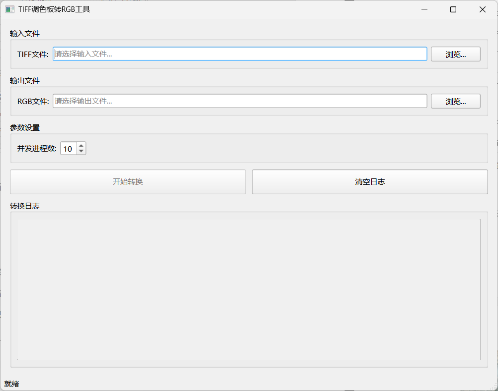

**输入文件区**：选择输入的TIFF文件路径。仅支持调色板模式（P mode）的TIFF图像。

**输出文件区**：选择输出RGB图像的保存路径。支持TIFF、PNG、JPEG等格式。选择输入文件后，输出路径会自动生成（在原文件名后添加_rgb后缀）。

**参数设置区**：设置并发进程数，默认为CPU核心数的一半。工具提示当前CPU核心数供参考。

**按钮区**：包含"开始转换"和"清空日志"两个按钮。输入和输出路径均有效时，"开始转换"按钮才会启用。

**转换日志区**：以带时间戳的彩色文本显示转换过程中的详细信息，包括输入输出信息、共享内存创建、分块处理、处理时间统计等。

**进度条**：转换过程中显示进度条。


---

### 7.3 操作步骤

**第一步：选择输入文件**

点击"浏览"按钮选择输入的TIFF文件。工具自动检查文件是否为调色板模式图像，若不是则报错提示。

**第二步：设置输出路径**

输出路径在选择输入文件后会自动生成（原文件名_rgb.原后缀）。如需修改，可点击"浏览"按钮重新选择。

**第三步：设置进程数**

在"并发进程数"输入框中设置进程数，默认为CPU核心数的一半。工具提示当前CPU核心数。

**第四步：开始转换**

点击"开始转换"按钮启动转换。日志区实时显示处理进度和统计信息。如果输出文件已存在，系统会弹出确认框询问是否覆盖。

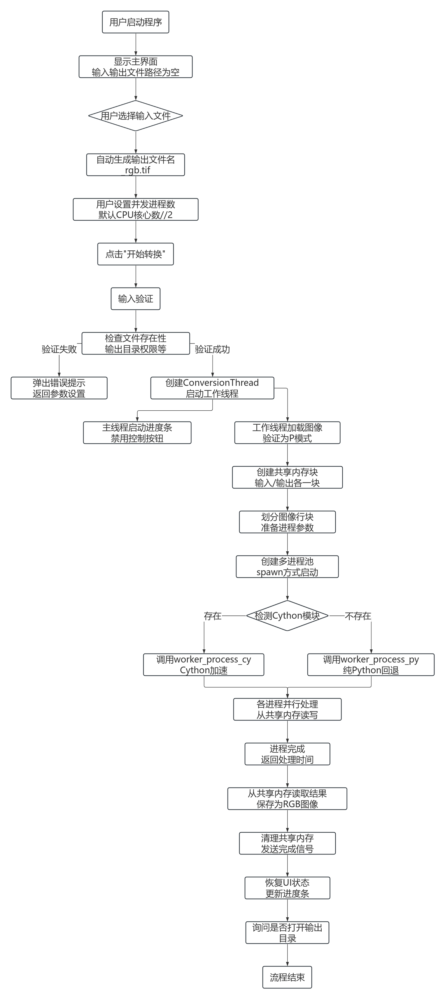

**第五步：查看结果**

转换完成后，系统弹出提示框询问是否打开输出文件所在目录。日志区显示总处理时间、像素数和吞吐率等统计信息。

### 7.4 技术原理

**调色板查找表（LUT）**：PIL库的调色板以长度为768的列表形式存储（[R0, G0, B0, R1, G1, B1, ..., R255, G255, B255]）。工具将其重塑为256x3的NumPy数组作为查找表（LUT）。转换时，每个像素的调色板索引值直接作为LUT的行索引，实现O(1)时间的索引查找，将单通道索引图转换为三通道RGB图。

**共享内存分块处理**：工具创建输入和输出两块共享内存：输入存储原始调色板索引数据（单通道），输出存储RGB结果数据（三通道）。将图像按行分块，每个进程负责一个行块的处理，通过共享内存直接写入结果，避免进程间数据传输。分块策略保证各进程负载均衡。


---

**Cython prange并行加速**：当palette_processor_cy模块（Cython编译版本）可用时，工具自动使用Cython版本进行像素级查表操作。Cython版本通过静态类型声明（cdef）和C级循环（prange并行区间）优化，将逐像素的查表操作编译为高效的机器码，并利用OpenMP实现多线程并行。处理速度显著优于纯Python版本，对上亿像素的巨幅图像加速效果尤为明显。

**双层加速策略**：工具采用Python回退+Cython加速的双层策略。启动时尝试导入palette_processor_cy模块，若导入成功则使用Cython加速版本；若导入失败（未编译Cython模块），则自动回退到纯Python版本的process_palette_block函数，保证功能可用性。这种设计使软件在未配置Cython编译环境时仍可正常运行，仅在性能上有所差异。

### 7.5 参数说明

| 参数 | 说明 | 取值范围 | 默认值 |
| --- | --- | --- | --- |
| file_path | 输入调色板TIFF路径 | P mode TIFF文件 | - |
| result_path | 输出RGB图像路径 | TIFF/PNG/JPEG | 自动生成 |
| proc_num | 并发进程数 | 1~CPU核心数 | CPU核心数/2 |

### 7.6 数据结构

调色板转换的数据流：

- 输入：P mode TIFF图像，每个像素为0-255的调色板索引值，配套768元素的调色板列表。
- LUT：256x3的NumPy数组，行索引为调色板索引，列依次为R、G、B通道值。
- 共享内存输入块：单通道索引数组，dtype为uint8。
- 共享内存输出块：三通道RGB数组，dtype为uint8，形状为(H, W, 3)。
- 输出：标准RGB图像，每个像素由LUT查表得到的三通道值组成。

### 7.7 错误处理

**输入文件不是调色板图像**：工具检查图像模式，如果不是P mode会报错。请确认输入TIFF文件确实使用调色板模式存储。

**Cython模块未找到**：工具会自动回退到纯Python版本，但处理速度较慢。日志区会提示当前使用的是Python版本还是Cython加速版本。如需加速，请使用setup.py编译palette_processor_cy.c文件。

**输出文件已存在**：系统弹出确认框询问是否覆盖，避免误覆盖已有文件。

**共享内存清理**：转换完成或异常退出时，工具主动释放输入和输出两块共享内存，避免内存泄漏。

### 7.8 Cython编译与加速

调色板转换工具的Cython加速模块编译步骤如下：

1. 确保系统已安装Cython编译环境（C编译器gcc/MSVC和Cython包）。
2. 在paletteTrans目录下执行编译命令：`python setup.py build_ext --inplace`。
3. 编译成功后生成palette_processor_cy.cpython-310-x86_64-linux-gnu.so（Linux）或.pyd（Windows）文件。
4. 工具启动时自动检测该模块是否可导入，若可导入则使用Cython加速版本。

Cython加速版本的核心优势：通过静态类型声明（cdef unsigned char等）消除Python动态类型开销；通过prange并行循环利用多核CPU；将逐像素的LUT查表操作编译为连续内存访问的机器码，显著提升缓存命中率。对于1亿像素的图像，Cython版本相比纯Python版本可获得约4倍的单进程加速，配合8进程并行可达20倍以上总加速。

### 7.9 处理流程详解

调色板转换的完整处理流程：

1. **读取输入**：通过PIL打开P mode TIFF图像，获取调色板索引矩阵和调色板列表。
2. **构建LUT**：将768元素调色板列表重塑为256x3的NumPy数组。
3. **创建共享内存**：创建输入共享内存（存储索引矩阵）和输出共享内存（存储RGB结果，尺寸为H x W x 3）。
4. **分块并行处理**：将图像按行分为proc_num块，每个进程处理一块，通过LUT查表将索引转换为RGB，写入输出共享内存对应区域。
5. **组装结果**：主进程从输出共享内存读取完整RGB数组，通过PIL/tifffile保存为输出文件。
6. **清理释放**：释放两块共享内存。


---

## 第8章 CLI版本使用说明

### 8.1 概述

每个工具均提供CLI（命令行界面）版本，适用于Linux超算集群等无图形界面的计算环境。CLI版本通过argparse解析命令行参数，配合tqdm进度条显示处理进度。每个工具目录下均有对应的.bat（Windows）和.sh（Linux）启动脚本，用户只需修改脚本中的参数值即可运行。CLI版本与GUI版本共享同一套核心算法，功能完全一致。

### 8.2 瓦片下载CLI

```
python multiDownloadCLI.py \
--root_dir "./satellite" \
--source 2 \
--level_start 13 \
--level_end 16 \
--LT_lat 36.161000 \
--LT_lon 103.553300 \
--RB_lat 36.020300 \
--RB_lon 103.955700 \
--workers_num 64
```

CLI版本支持级别范围下载（level_start至level_end），自动逐级下载并统计各级别结果。配合tqdm进度条显示总体进度。参数说明详见下表：

| 参数 | 说明 | 取值 | 默认值 |
| --- | --- | --- | --- |
| --root_dir | 保存根目录 | 有效路径 | 必填 |
| --source | 数据源 | 0-3 | 2 |
| --level_start | 起始缩放级别 | 1-22 | 必填 |
| --level_end | 终止缩放级别 | 1-22 | 必填 |
| --LT_lat | 左上角纬度 | -90~90 | 必填 |
| --LT_lon | 左上角经度 | -180~180 | 必填 |
| --RB_lat | 右下角纬度 | -90~90 | 必填 |
| --RB_lon | 右下角经度 | -180~180 | 必填 |
| --workers_num | 并发线程数 | 1-4096 | 100 |


---

### 8.3 瓦片分割CLI

```
python tileSplitCLI.py \
--file_path "遥感图像路径" \
--result_dir "瓦片保存根目录" \
--result_format "png" \
--x_begin 0 --x_step 1 \
--y_begin 0 --y_step 1 \
--tile_width 256 --tile_height 256 \
--tile_channels 3 \
--proc_num 8
```

参数说明：

| 参数 | 说明 | 取值 | 默认值 |
| --- | --- | --- | --- |
| --file_path | 输入图像路径 | 有效图像 | 必填 |
| --result_dir | 保存根目录 | 有效路径 | 必填 |
| --result_format | 输出格式 | png/jpeg/tiff | png |
| --x_begin | X轴起始编号 | 整数 | 0 |
| --x_step | X轴步长 | 正整数 | 1 |
| --y_begin | Y轴起始编号 | 整数 | 0 |
| --y_step | Y轴步长 | 正整数 | 1 |
| --tile_width | 瓦片宽度 | 正整数 | 256 |
| --tile_height | 瓦片高度 | 正整数 | 256 |
| --tile_channels | 通道数 | 1/3 | 3 |
| --proc_num | 进程数 | 1~CPU核心 | CPU核心数 |

### 8.4 瓦片合并CLI

```
python tileCombineCLI.py \
--root_dir "瓦片根目录" \
--result_path "输出路径" \
--x_begin 1651817 --x_end 1652613 --x_step 4 \
--y_begin 822436 --y_end 823328 --y_step 4 \
--tile_width 1024 --tile_height 1024 \
--tile_format ".png" \
--tile_channels 3 \
--proc_num 96
```

CLI版本需手动指定瓦片编号范围和步长（GUI版本可自动检测）。在超算集群上可设置较高的进程数（如96）以充分利用多核资源。参数说明：

| 参数 | 说明 | 取值 | 默认值 |
| --- | --- | --- | --- |
| --root_dir | 瓦片根目录 | 有效路径 | 必填 |
| --result_path | 输出路径 | 有效路径 | 必填 |
| --x_begin | X轴起始编号 | 整数 | 必填 |
| --x_end | X轴终止编号 | 整数 | 必填 |
| --x_step | X轴步长 | 正整数 | 必填 |
| --y_begin | Y轴起始编号 | 整数 | 必填 |
| --y_end | Y轴终止编号 | 整数 | 必填 |
| --y_step | Y轴步长 | 正整数 | 必填 |
| --tile_width | 瓦片宽度 | 正整数 | 必填 |
| --tile_height | 瓦片高度 | 正整数 | 必填 |
| --tile_format | 瓦片后缀 | .png/.jpg/.tif | 必填 |
| --tile_channels | 通道数 | 1/3 | 3 |
| --proc_num | 进程数 | 1~CPU核心 | CPU核心数 |


---

### 8.5 色彩平衡CLI

色彩平衡CLI版本为交互式程序，运行后通过终端输入逐步引导用户完成操作。程序会在终端中显示处理过程中的预览图（通过term_image库渲染）。

```
python colorBalanceCLI.py
```

运行后依次提示：输入分割灵敏度、输入图片路径、选择分割线、选择基准图块、输入保存路径。CLI版本与GUI版本功能一致，区别在于预览图在终端中以字符形式渲染显示。

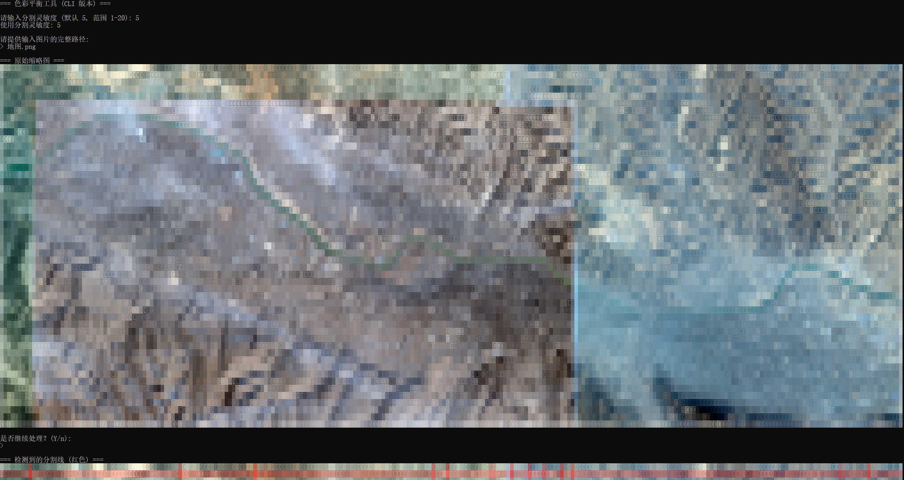

色彩平衡CLI版本无命令行参数，全部通过交互式输入完成配置。这种设计使色彩平衡这一需要人工判断的操作在无图形界面环境下也能完成，term_image库将图像渲染为终端字符画，用户可在SSH终端中查看预览效果。

### 8.6 调色板转换CLI

```
python paletteTransCLI.py \
--file_path "./input_palette.tif" \
--result_path "./output_rgb.tif" \
--proc_num 8
```

--proc_num可选，默认为CPU核心数的一半。程序自动检测Cython模块是否可用，若可用则使用加速版本。参数说明：

| 参数 | 说明 | 取值 | 默认值 |
| --- | --- | --- | --- |
| --file_path | 输入调色板TIFF | P mode TIFF | 必填 |
| --result_path | 输出RGB路径 | TIFF/PNG/JPEG | 必填 |
| --proc_num | 进程数 | 1~CPU核心 | CPU核心/2 |

### 8.7 超算集群使用建议

在Linux超算集群上使用CLI版本时，建议通过SLURM等作业调度系统提交任务。将参数配置写入.sh脚本，在脚本中加载conda环境后执行CLI程序。对于大规模批处理任务，建议将--proc_num设置为集群分配的CPU核心数，充分利用并行计算资源。所有工具在启动时设置Image.MAX_IMAGE_PIXELS = None，取消PIL库对大图处理的默认限制，支持处理上亿像素的图像。

### 8.8 Windows批处理脚本示例

在Windows环境下，可通过.bat脚本运行CLI版本。以下为瓦片分割的批处理脚本示例：

```bat
@echo off
chcp 65001
call conda activate zhitu

python tileSplitCLI.py ^
  --file_path "D:\data\remote_sensing.tif" ^
  --result_dir "D:\data\tiles" ^
  --result_format "png" ^
  --x_begin 0 --x_step 1 ^
  --y_begin 0 --y_step 1 ^
  --tile_width 256 --tile_height 256 ^
  --tile_channels 3 ^
  --proc_num 8

pause
```

脚本中`chcp 65001`设置控制台为UTF-8编码，避免中文路径显示乱码。`call conda activate zhitu`激活conda虚拟环境。参数使用`^`续行符分行书写，便于阅读和修改。脚本末尾`pause`使窗口在程序结束后保持打开，便于查看输出结果。


---

## 第9章 常见问题与错误处理

### 9.1 瓦片下载相关

**下载失败率较高**：可能是网络不稳定或服务器限流。建议降低并发线程数（如从64降到32），增加重试次数（如从2次增加到5次），增大超时时间（如从3秒增加到10秒）。指数退避重试机制会自动处理瞬时网络故障。

**部分瓦片下载失败**：失败的瓦片信息记录在保存目录下的download_errors_zoom{级别}.txt文件中，包含失败瓦片的X、Y坐标和错误原因。可重新运行下载任务，已存在的瓦片会自动跳过（断点续传），仅下载缺失的瓦片。

**地理范围设置错误**：确保左上角纬度大于右下角纬度（北半球），左上角经度小于右下角经度。工具会进行输入验证并提示错误，非法坐标将阻止下载启动。

**瓦片数量过多导致下载缓慢**：高级别缩放（如18级以上）在小区域内也会产生大量瓦片。建议分批下载，或降低缩放级别，或使用CLI版本在带宽充足的服务器上以高并发运行。

### 9.2 瓦片分割相关

**内存不足**：处理超大图像时，共享内存分配可能失败。建议减小图像尺寸或增加系统内存。工具会在分配前计算所需内存并显示，超过1GB时会发出警告。

**图像尺寸非瓦片整数倍**：图像边缘的剩余像素无法生成完整瓦片，工具会提示剩余像素数量。这些边缘区域将被忽略，不影响主体分割。

**通道数不匹配**：如果指定的通道数与图像实际通道数不一致，工具会发出警告并执行自适应转换。单通道图像可转换为RGB，三通道图像可转换为单通道灰度。

**共享内存残留**：程序异常崩溃后共享内存可能未释放。重启工具时若提示共享内存已存在，需手动清理或重启系统。

### 9.3 瓦片合并相关

**瓦片文件缺失**：合并时如果某些瓦片文件不存在，对应位置将保持黑色（初始值0）。工具会统计并报告失败的瓦片位置，便于补下缺失瓦片后重新合并。

**输出图像过大**：合并大量高分辨率瓦片会生成超大图像，需要足够的内存。工具会预先计算输出图像尺寸和内存需求，超过1GB时发出警告。

**自动参数检测失败**：若瓦片目录结构不规范（如包含非数字命名的子目录），自动检测可能失败。建议手动输入参数或整理目录结构。


---

### 9.4 色彩平衡相关

**图像非RGB模式**：调色板（P）模式或灰度（L）模式的图像无法直接处理。请先使用调色板转换工具将其转换为RGB模式。

**检测到的分割线过多或过少**：通过调整分割灵敏度参数控制检测灵敏度。灵敏度越高，检测到的分割线越多。范围1-20，默认5。可在自动检测后手动选择保留的分割线，剔除误检结果。

**系统资源不足**：处理超大图像时，共享内存分配可能失败。工具会提示"系统资源不足，任务中止"，建议减小图像尺寸或增加系统内存。

**色彩匹配效果不理想**：尝试更换基准图块，选择色彩表现最自然、最具代表性的区域作为基准。也可调整分割线，使色彩分块更准确地反映实际色彩边界。

### 9.5 调色板转换相关

**输入文件不是调色板图像**：工具检查图像模式，如果不是P mode会报错。请确认输入TIFF文件确实使用调色板模式存储。可通过PIL的Image.open()查看image.mode属性确认。

**Cython模块未找到**：工具会自动回退到纯Python版本，但处理速度较慢。日志区会提示当前使用的版本。如需加速，请使用setup.py编译palette_processor_cy.c文件，生成palette_processor_cy模块。

**输出文件颜色异常**：检查输入TIFF的调色板是否完整（768元素）。若调色板数据损坏，转换结果颜色将不正确。

### 9.6 通用问题

**多进程在Windows下异常**：所有工具在Windows环境下均使用freeze_support()和spawn方式启动子进程，确保多进程稳定性。如果使用PyInstaller打包，请确保spec文件中正确配置了multiprocessing支持。

**路径包含中文或空格**：建议使用英文路径，避免潜在的编码问题。如必须使用中文路径，请确保系统编码设置为UTF-8。

**PIL最大像素限制**：所有工具在启动时设置Image.MAX_IMAGE_PIXELS = None，取消PIL库对大图处理的默认限制（默认约1.78亿像素），支持处理上亿像素的图像。

**依赖库版本冲突**：建议使用conda创建独立虚拟环境，通过conda-forge渠道安装依赖库，避免与系统其他Python项目冲突。

### 9.7 多进程与共享内存问题

**共享内存名称冲突**：若多个工具实例同时运行，可能因共享内存名称相同而冲突。建议避免同时运行多个同类工具实例，或等待前一个任务完成后再启动新任务。

**Linux下/dev/shm空间不足**：Linux系统的共享内存默认挂载在/dev/shm，大小通常为内存的50%。处理超大图像时可能超出限制。可通过`df -h /dev/shm`查看可用空间，必要时修改/etc/fstab调整tmpfs大小。

**进程池启动失败**：在Windows环境下，若主模块未正确使用`if __name__ == '__main__':`保护，多进程可能启动失败。所有工具已内置freeze_support()调用，确保spawn方式正常工作。

### 9.8 输出文件问题

**输出文件无法打开**：可能是文件未写入完整（处理中断）或格式不正确。建议确认处理正常完成后再次尝试打开。TIFF文件可尝试用tifffile或ImageJ打开。

**输出图像颜色异常**：色彩平衡后若颜色失真，可能是基准图块选择不当或分割线位置不准。建议重新选择基准图块（选择色彩最自然的区域）或调整分割线。

**输出文件过大**：合并大量高分辨率瓦片会生成超大文件。可考虑使用TIFF格式（支持大文件）而非PNG，或在分割阶段使用较小的瓦片尺寸分批处理。


---

## 第10章 性能指标与对比分析

### 10.1 性能指标

本软件各模块在典型硬件环境下的性能指标如下（测试环境：Intel x86_64 PC，16GB内存，SSD存储，8核CPU）：

| 模块 | 测试场景 | 关键指标 | 性能表现 |
| --- | --- | --- | --- |
| 瓦片下载 | 16级兰州区域约1万瓦片，64线程 | 下载吞吐率 | 约200瓦片/秒 |
| 瓦片分割 | 40000x40000像素RGB图像，256x256瓦片，8进程 | 处理吞吐率 | 约5000瓦片/秒 |
| 瓦片合并 | 约2500个1024x1024瓦片合并，8进程 | 处理吞吐率 | 约300瓦片/秒 |
| 色彩平衡 | 8000x8000像素RGB图像，4x4分块，8进程 | 处理时间 | 约15秒 |
| 调色板转换 | 1亿像素P mode TIFF，Cython加速，8进程 | 处理吞吐率 | 约5000万像素/秒 |

### 10.2 并行加速效果

共享内存零拷贝架构使多进程加速接近线性。以瓦片分割为例，单进程处理40000x40000图像约需40秒，8进程并行约需8秒，加速比约5倍。随着进程数增加，加速比受内存带宽和IO瓶颈限制逐渐趋缓。调色板转换在Cython加速下，8进程并行相比单进程纯Python版本加速可达20倍以上，其中Cython编译优化贡献约4倍，多进程并行贡献约5倍。

### 10.3 竞品对比分析

本软件与主流GIS/遥感处理软件的功能对比如下：

| 对比项 | 智图匀影 V1.0 | QGIS | ArcGIS | GDAL |
| --- | --- | --- | --- | --- |
| 瓦片批量下载 | 支持，多线程万级瓦片 | 需插件，功能有限 | 不支持批量瓦片下载 | 不支持 |
| 瓦片分割 | 共享内存多进程，二维进度可视化 | 支持但无并行优化 | 支持但操作繁琐 | 支持但无GUI |
| 瓦片合并 | 自动参数检测，并行拼接 | 支持但无自动检测 | 支持但操作繁琐 | 支持但无GUI |
| 色彩平衡 | 梯度分割+直方图匹配，交互式 | 仅基础直方图均衡 | 功能强大但操作复杂 | 仅命令行工具 |
| 调色板转换 | Cython加速，亿级像素 | 支持但无加速 | 支持 | 支持但无加速 |
| GUI+CLI双版本 | 全模块双版本 | 仅GUI | 仅GUI | 仅CLI |
| 超算集群支持 | 原生支持Linux CLI | 不适合 | 不适合 | 适合 |
| AI训练数据适配 | 专为深度学习瓦片化优化 | 通用GIS，未优化 | 通用GIS，未优化 | 通用工具，未优化 |
| 轻量化 | 纯Python，轻量 | 体积庞大 | 体积庞大 | C++依赖较多 |


---

### 10.4 技术优势分析

**全流程闭环**：智图匀影覆盖从数据下载到训练数据制备的完整流程，五大模块可串联使用，而QGIS、ArcGIS等通用GIS软件需多个工具配合才能完成相同流程。

**深度学习适配**：软件专为遥感AI训练数据预处理设计，瓦片尺寸、格式、通道数等参数均面向深度学习模型输入标准，而通用GIS软件未针对此场景优化。

**共享内存并行**：所有计算密集型模块采用共享内存零拷贝架构，突破Python多进程内存复制限制，对GB级大图处理效率显著优于基于序列化传输的方案。

**双版本设计**：全模块提供GUI和CLI双版本，GUI适合桌面交互操作，CLI适合超算集群批量运行，覆盖科研全场景需求。通用GIS软件通常仅提供单一交互方式。

**轻量化部署**：纯Python实现，依赖库少，部署简单，适合在超算集群快速部署。QGIS和ArcGIS体积庞大、部署复杂，不适合超算环境。

### 10.5 适用场景与局限性

**适用场景**：遥感深度学习训练数据制备、多源遥感影像色彩统一、巨幅遥感影像分割合并处理、调色板影像格式标准化、超算集群批量瓦片处理。

**局限性**：瓦片下载依赖公开地图服务，数据源覆盖范围受服务限制；色彩平衡为分块直方图匹配，对渐变色彩过渡区域的处理效果有限；软件主要面向遥感瓦片图处理，不具备矢量数据处理、空间分析等通用GIS功能。

### 10.6 进程数优化建议

不同任务类型的最佳进程数配置建议：

| 任务类型 | 推荐进程数 | 说明 |
| --- | --- | --- |
| 瓦片下载 | 网络带宽决定 | IO密集型，线程数取决于带宽，64-4096 |
| 瓦片分割 | CPU核心数 | 计算密集型，充分利用所有核心 |
| 瓦片合并 | CPU核心数 | IO与计算混合，建议等于核心数 |
| 色彩平衡 | CPU核心数 | 计算密集型，等于核心数 |
| 调色板转换(Cython) | CPU核心数 | 计算密集型，等于核心数 |
| 调色板转换(Python) | CPU核心数 | 计算密集型，等于核心数 |

注意：进程数并非越多越好。超过CPU物理核心数后，进程切换开销增大，性能反而下降。对于IO密集型任务（瓦片下载），由于线程大部分时间等待网络响应，可设置远高于核心数的线程数；对于计算密集型任务，进程数应不超过CPU核心数。

### 10.7 内存占用分析

各模块处理不同规模数据时的内存占用参考：

| 模块 | 数据规模 | 内存占用 | 说明 |
| --- | --- | --- | --- |
| 瓦片分割 | 40000x40000 RGB | 约4.8GB | 原图共享内存+进度内存 |
| 瓦片合并 | 40000x40000 RGB | 约4.8GB | 总图共享内存 |
| 色彩平衡 | 8000x8000 RGB | 约200MB | 缩略图+原图共享内存 |
| 调色板转换 | 1亿像素 | 约400MB | 输入+输出共享内存 |

共享内存架构的内存占用主要由图像数据本身决定（H x W x C x dtype字节数）。处理前工具会预估内存需求并提示用户，超过1GB时发出警告，便于用户评估系统资源是否充足。


---

## 附录 参数参考表

### A.1 瓦片下载CLI参数（multiDownloadCLI.py）

| 参数 | 类型 | 必填 | 说明 | 默认值 |
| --- | --- | --- | --- | --- |
| --root_dir | str | 是 | 瓦片保存根目录 | - |
| --source | int | 否 | 数据源（0:Google Earth, 1:高德矢量, 2:高德卫星, 3:高德路网） | 2 |
| --level_start | int | 是 | 起始缩放级别（1-22） | - |
| --level_end | int | 是 | 终止缩放级别（1-22） | - |
| --LT_lat | float | 是 | 左上角纬度（WGS84） | - |
| --LT_lon | float | 是 | 左上角经度（WGS84） | - |
| --RB_lat | float | 是 | 右下角纬度（WGS84） | - |
| --RB_lon | float | 是 | 右下角经度（WGS84） | - |
| --workers_num | int | 否 | 并发下载线程数（1-4096） | 100 |

### A.2 瓦片分割CLI参数（tileSplitCLI.py）

| 参数 | 类型 | 必填 | 说明 | 默认值 |
| --- | --- | --- | --- | --- |
| --file_path | str | 是 | 输入遥感图像路径 | - |
| --result_dir | str | 是 | 瓦片保存根目录 | - |
| --result_format | str | 否 | 输出格式（png/jpeg/tiff） | png |
| --x_begin | int | 否 | X轴起始编号 | 0 |
| --x_step | int | 否 | X轴步长 | 1 |
| --y_begin | int | 否 | Y轴起始编号 | 0 |
| --y_step | int | 否 | Y轴步长 | 1 |
| --tile_width | int | 否 | 瓦片宽度（像素） | 256 |
| --tile_height | int | 否 | 瓦片高度（像素） | 256 |
| --tile_channels | int | 否 | 通道数（1:灰度, 3:RGB） | 3 |
| --proc_num | int | 否 | 并行进程数 | CPU核心数 |


---

### A.3 瓦片合并CLI参数（tileCombineCLI.py）

| 参数 | 类型 | 必填 | 说明 | 默认值 |
| --- | --- | --- | --- | --- |
| --root_dir | str | 是 | 瓦片图根目录 | - |
| --result_path | str | 是 | 合并结果保存路径 | - |
| --x_begin | int | 是 | X轴起始编号 | - |
| --x_end | int | 是 | X轴终止编号 | - |
| --x_step | int | 是 | X轴步长 | - |
| --y_begin | int | 是 | Y轴起始编号 | - |
| --y_end | int | 是 | Y轴终止编号 | - |
| --y_step | int | 是 | Y轴步长 | - |
| --tile_width | int | 是 | 瓦片宽度（像素） | - |
| --tile_height | int | 是 | 瓦片高度（像素） | - |
| --tile_format | str | 是 | 瓦片文件后缀（.png/.jpg/.tif） | - |
| --tile_channels | int | 否 | 通道数（1/3） | 3 |
| --proc_num | int | 否 | 并行进程数 | CPU核心数 |

### A.4 色彩平衡CLI（colorBalanceCLI.py）

色彩平衡CLI为交互式程序，无命令行参数。运行后按提示依次输入：分割灵敏度（1-20）、图片路径、保留的竖直分割线序号、保留的水平分割线序号、基准图块行列号、保存路径。

### A.5 调色板转换CLI参数（paletteTransCLI.py）

| 参数 | 类型 | 必填 | 说明 | 默认值 |
| --- | --- | --- | --- | --- |
| --file_path | str | 是 | 输入调色板TIFF路径（P mode） | - |
| --result_path | str | 是 | 输出RGB图像路径 | - |
| --proc_num | int | 否 | 并行进程数 | CPU核心数/2 |

### A.6 术语表

| 术语 | 说明 |
| --- | --- |
| 瓦片（Tile） | 按墨卡托投影切割的矩形地图图像块，通常为256x256像素 |
| 墨卡托投影 | Web地图常用的圆柱投影，EPSG:3857坐标系 |
| 缩放级别（Zoom Level） | 地图缩放层级，1-22级，级别越高越精细 |
| 共享内存（Shared Memory） | 多进程间共享的内存区域，实现零拷贝数据访问 |
| 调色板模式（P mode） | 单通道索引图像，配套调色板映射索引到RGB |
| LUT（查找表） | Look-Up Table，通过索引查表实现快速颜色映射 |
| 直方图匹配 | 调整图像直方图分布使其与目标图像一致的算法 |
| LAB色彩空间 | 亮度（L）和色彩通道组成，接近人眼感知 |
| Cython | Python的C扩展，编译为机器码提升执行效率 |
| 断点续传 | 中断后从断点继续，跳过已完成部分 |

### A.7 支持的文件格式

| 格式 | 扩展名 | 读 | 写 | 说明 |
| --- | --- | --- | --- | --- |
| PNG | .png | 支持 | 支持 | 无损压缩，支持透明通道 |
| JPEG | .jpg/.jpeg | 支持 | 支持 | 有损压缩，文件小 |
| TIFF | .tif/.tiff | 支持 | 支持 | 支持调色板模式，适合大图 |
| BMP | .bmp | 支持 | 不支持 | Windows位图，色彩平衡输入 |

### A.8 缩放级别与地面分辨率对照

赤道处不同缩放级别对应的单瓦片（256x256像素）地面分辨率：

| 缩放级别 | 地面分辨率（米/像素） | 单瓦片覆盖范围 | 适用场景 |
| --- | --- | --- | --- |
| 10 | 约152米 | 约39km | 省级概览 |
| 12 | 约38米 | 约9.7km | 城市级 |
| 14 | 约9.6米 | 约2.4km | 区县级 |
| 16 | 约2.4米 | 约614米 | 街道级 |
| 18 | 约0.6米 | 约153米 | 建筑物级 |
| 20 | 约0.15米 | 约38米 | 高精度 |

### A.9 批处理脚本示例

以下为Linux超算集群上批量处理的shell脚本示例：

```bash
#!/bin/bash
# 批量瓦片下载与分割脚本
# 提交方式: sbatch batch_pipeline.sh
#SBATCH --job-name=zhitu_pipeline
#SBATCH --partition=cpu
#SBATCH --nodes=1
#SBATCH --ntasks-per-node=96
#SBATCH --mem=128G

# 加载conda环境
source activate zhitu

# 第一步：批量下载瓦片（13-16级）
python multiDownloadCLI.py \
  --root_dir "./data/tiles" \
  --source 2 \
  --level_start 13 --level_end 16 \
  --LT_lat 36.161 --LT_lon 103.553 \
  --RB_lat 36.020 --RB_lon 103.956 \
  --workers_num 64

# 第二步：合并瓦片为大幅影像
python tileCombineCLI.py \
  --root_dir "./data/tiles/高德卫星影像/16" \
  --result_path "./data/merged.tif" \
  --x_begin 1651817 --x_end 1652613 --x_step 4 \
  --y_begin 822436 --y_end 823328 --y_step 4 \
  --tile_width 1024 --tile_height 1024 \
  --tile_format ".png" --tile_channels 3 \
  --proc_num 96

# 第三步：分割为256x256训练瓦片
python tileSplitCLI.py \
  --file_path "./data/merged.tif" \
  --result_dir "./data/training_tiles" \
  --result_format "png" \
  --tile_width 256 --tile_height 256 \
  --tile_channels 3 \
  --proc_num 96

echo "数据处理流水线完成"
```

### A.10 墨卡托投影坐标转换公式

瓦片下载工具使用的Web墨卡托投影（EPSG:3857）坐标转换公式：

**经纬度转瓦片行列号**（deg2num）：

```
n = 2^zoom
xtile = int((lon_deg + 180.0) / 360.0 * n)
lat_rad = radians(lat_deg)
ytile = int((1.0 - ln(tan(lat_rad) + 1/cos(lat_rad)) / pi) / 2.0 * n)
```

**瓦片行列号转经纬度**（num2deg，左上角）：

```
n = 2^zoom
lon_deg = xtile / n * 360.0 - 180.0
lat_rad = arctan(sinh(pi * (1 - 2 * ytile / n)))
lat_deg = degrees(lat_rad)
```

其中zoom为缩放级别，lat_deg/lon_deg为WGS84经纬度，xtile/ytile为瓦片行列号。该公式保证全球范围内经纬度与瓦片索引的双向精确映射。

### A.11 版本更新历史

| 版本 | 日期 | 更新内容 |
| --- | --- | --- |
| V1.0 | 2026-04-15 | 首次发布，包含瓦片下载、分割、合并、色彩平衡、调色板转换五大模块，GUI与CLI双版本 |

### A.12 联系与反馈

本软件为个人开发作品，著作权人为赵元丞、王杰。如在使用过程中遇到问题或有功能建议，可通过软件源代码仓库提交issue反馈。使用前请确保已阅读本用户手册的常见问题章节，大部分常见问题均已有解答。


---

<div style="text-align: center; font-size: 14px; color: #999;">— 用户手册结束 —</div>
